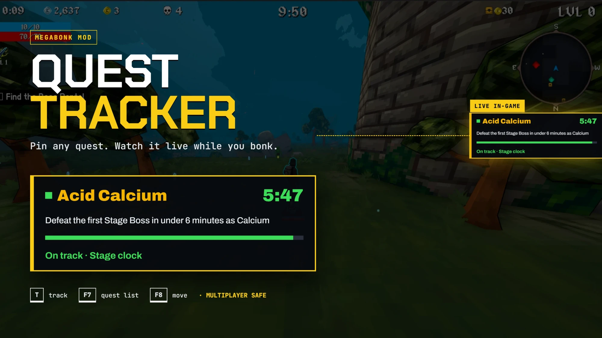

# Quest Tracker — source

Pin any quest in **Megabonk** and track it live while you play: progress, kills left, countdown timers, and on-track / failed / complete status. Includes a **no-spoiler quest guide** that tells you where to play and how to finish each quest, with a compass to places you've already found. BepInEx 6 (IL2CPP) plugin.

Players download it from:
- [Nexus Mods](https://www.nexusmods.com/megabonk/mods/192) (main page, with an All-in-One zip that includes BepInEx)
- [Thunderstore](https://thunderstore.io/c/megabonk/p/AhmedHus21/QuestTracker/) (for r2modman / Gale)



## Features

- **Track quests from anywhere**: double-click a quest in the main menu, a locked skin, or a locked unlock, or hover any quest and press **T**. **F7** opens a searchable quest list.
- **Live progress**: "10,840 / 12,500 · 1,660 left · +312 this run". Level quests (tomes, weapons, character level) count live during a run.
- **Timers** for timed quests, with pass / fail status and boss-clock alerts ("Summon the boss NOW!").
- **Quest guide** (F10):
  - where to play (map, tier, stage) when a quest needs it
  - "How:" hints for hidden and multi-step quests (Spooky Steve, Big Bob, frogs, crypts…)
  - a compass around your character that only points at things you've already found; until then it just says what to look for
- **Keys window** (F7 → Keys): rebind every key; keys the game uses are refused.
- **Move / resize** the panel with **F8**. English and Arabic (switches automatically with Megabonk Arabic).
- **Multiplayer safe**: it only reads quest info and draws on screen. It never changes the game, so it works with BonkWithFriends / MegabonkTogether.

## Layout

```
src/                    the plugin (C#, net6.0)
  Plugin.cs             entry point; the version number is here and in the .csproj
  Tracker.cs            reads quest state, timers, pass/fail
  Hud.cs                the tracker panel, toasts, keys
  Picker.cs             the F7 quest list
  KeyBinder.cs          the F7 → Keys window
  Guide.cs              the quest guide compass ("found" rules, crypt areas)
  GuideTargets.cs       which quest points at what, plus the "How:" hints
  QuestPlace.cs         map / tier / stage a quest needs
  LevelQuests.cs        live levels for tome / weapon / character-level quests
  Rtl.cs, RtlShaper.cs  Arabic shaping for Unity's IMGUI
  UpdateChecker.cs      "new version on Nexus" notice in the menus
QuestTracker.csproj     project file (references the game's BepInEx files)
package/                README / INSTALL texts copied into the release zips
media/                  screenshots
thunderstore/           the Thunderstore page readme
NEXUS_DESCRIPTION.txt   the Nexus page text (BBCode)
build.ps1               builds the plugin and makes the release zips in .\dist
```

## Build

Needs the **.NET 6 SDK or newer**, and Megabonk with **BepInEx 6 (IL2CPP)** started at least once (the project references the game's BepInEx and interop files).

```
powershell -ExecutionPolicy Bypass -File .\build.ps1
```

This builds the DLL and makes two zips in `.\dist`: the mod only, and an All-in-One with BepInEx. If the game isn't in the default Steam folder, pass `-GameDir "D:\...\Megabonk"`.

The Thunderstore package is built by a shared script outside this repo (it packs several of the author's mods); `thunderstore/README.md` is the readme it uses.

## Rules for changes

- **Read-only**: Quest Tracker never changes game state. That's what keeps it co-op safe.
- Every player-facing string goes through `L.T(english, arabic)`. Both languages, always.
- No spoilers in the guide: never point at the Boss Portal, crypts or hidden things before the player has found them.
- No release without the author's OK. A release = Nexus (both zips) **and** Thunderstore.

## Credits

Special thanks to **sensei**, my friend and teacher.
Thanks to **pinkpomelo**, the **BepInEx team** (mod loader), **Il2CppInterop** (IL2CPP bridge), and **Harmony** by Andreas Pardeike (pardeike).
